# Microsoft Entra ID と SAML 連携

Microsoft Entra ID (旧 Azure Active Directory) と SAML 連携を行う参考手順を紹介します。詳細なパラメーターは各環境に合わせて変更してください。

# 事前作業

このアプリの初回デプロイを行います（[デプロイと設定ガイド](DEPLOYMENT.md)）。初回デプロイを行ったあと、Cognito と Entra ID の SAML 連携を行います。

CloudFormation のスタック（`OcrAppStack`、環境を指定した場合は `OcrAppStack-<env>`）の画面で「出力」タブを開き、次の 2 つの値をメモします。

- `WebConstructCloudFrontURL...`：Web サイトの URL（以降 WebUrl と呼びます）
- `AuthUserPoolId...`：Cognito ユーザープールの ID

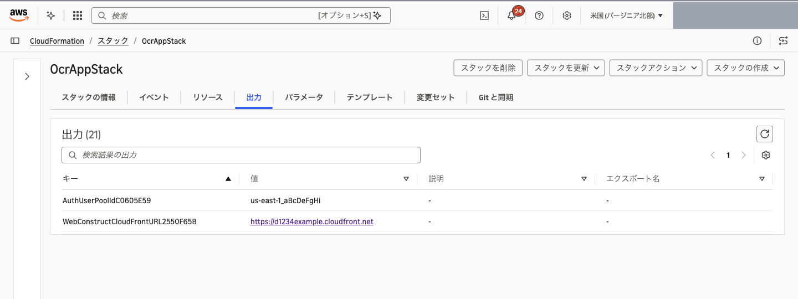

# Cognito の設定 : ドメイン

Cognito ドメインを設定します。Amazon Cognito のコンソールで対象のユーザープールを開き、左メニューの「ブランディング」>「ドメイン」を選択します。Cognito ドメインが「-」（未設定）であれば、「Cognito ドメイン」の「ドメインを作成」を押します。

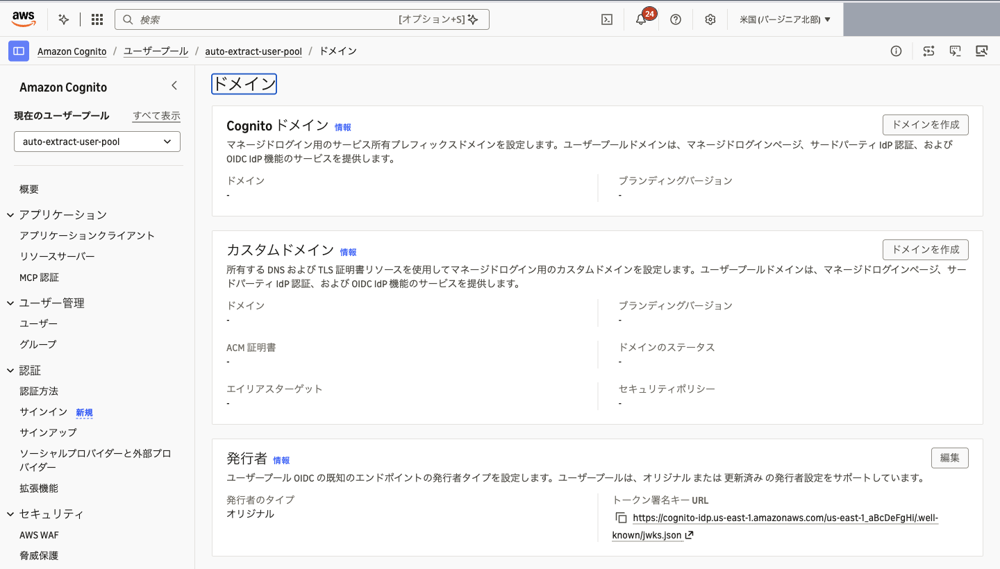

任意のドメインプレフィックスを入力し、「Cognito ドメインの作成」を押します。この手順では `your-preferred-name` とします。リージョン内で一意の名前にする必要があります。ブランディングバージョンは「マネージドログイン - 推奨」のままで構いません。

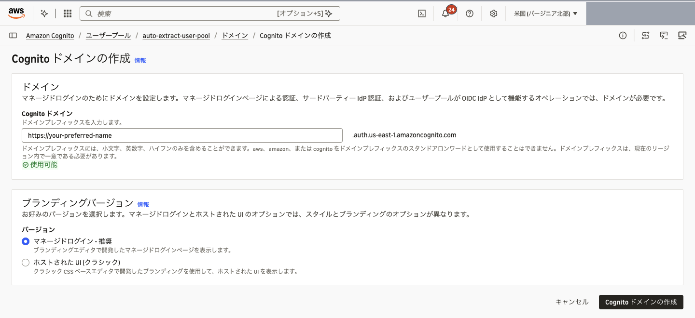

作成されたドメイン（`your-preferred-name.auth.<リージョン>.amazoncognito.com`）は、この後の Entra ID の設定と `lib/parameters.ts` で使います。

# Microsoft Entra ID の設定

[Microsoft Entra 管理センター](https://entra.microsoft.com/) で SAML 連携を有効化します。

左メニューの Entra ID > Enterprise apps を開き、New application を選択します。

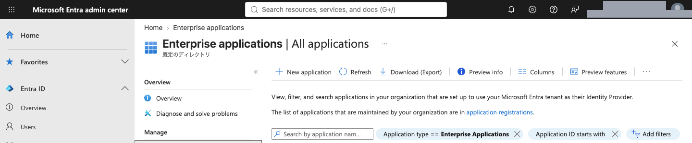

Create your own application を選択します。

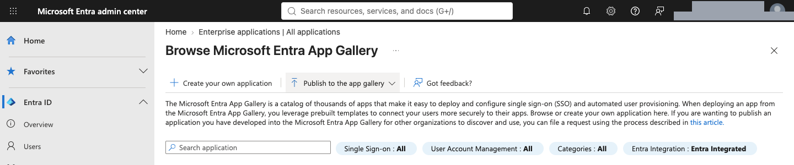

任意のアプリケーション名（この例では `auto-extract`）を入力し、「Integrate any other application you don't find in the gallery (Non-gallery)」を選択して Create を押します。

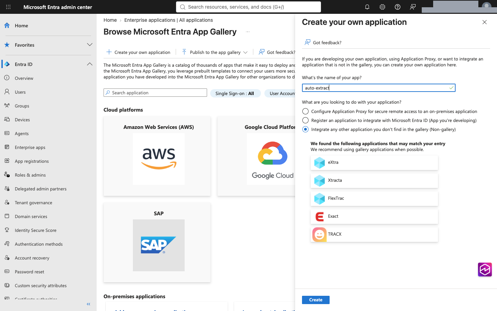

作成したアプリケーションの Single sign-on のメニューから SAML を選択します。

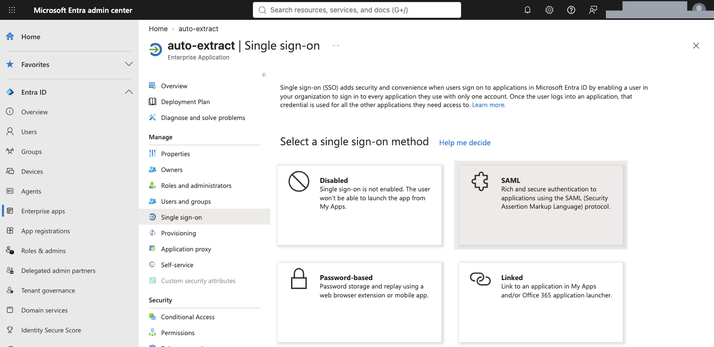

SAML-based Sign-on の画面が表示されます。Basic SAML Configuration にある Edit を押します。

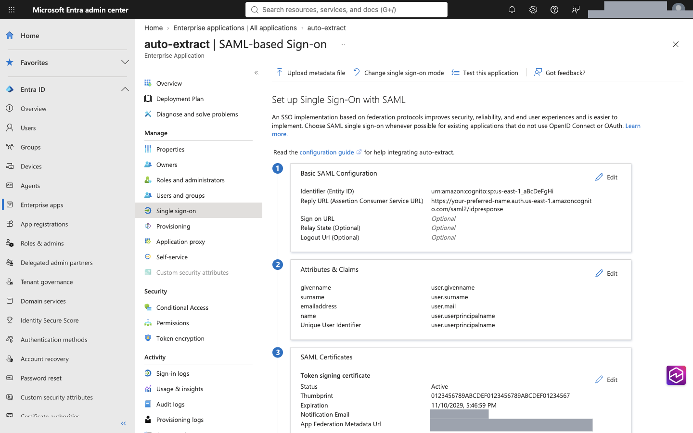

次のパラメータを入れて Save を押します。[事前作業](#事前作業)で確認した Cognito ユーザープールの ID と、[Cognito の設定 : ドメイン](#cognito-の設定--ドメイン) で作成したドメインを利用します。

Identifier (Entity ID)

```
# フォーマット
urn:amazon:cognito:sp:<UserPoolID>

# 入力例
urn:amazon:cognito:sp:ap-northeast-1_aBcDeFgHi
```

Reply URL (Assertion Consumer Service URL)

```
# フォーマット
https://<入力した値>.auth.<リージョン>.amazoncognito.com/saml2/idpresponse

# 入力例
https://your-preferred-name.auth.ap-northeast-1.amazoncognito.com/saml2/idpresponse
```

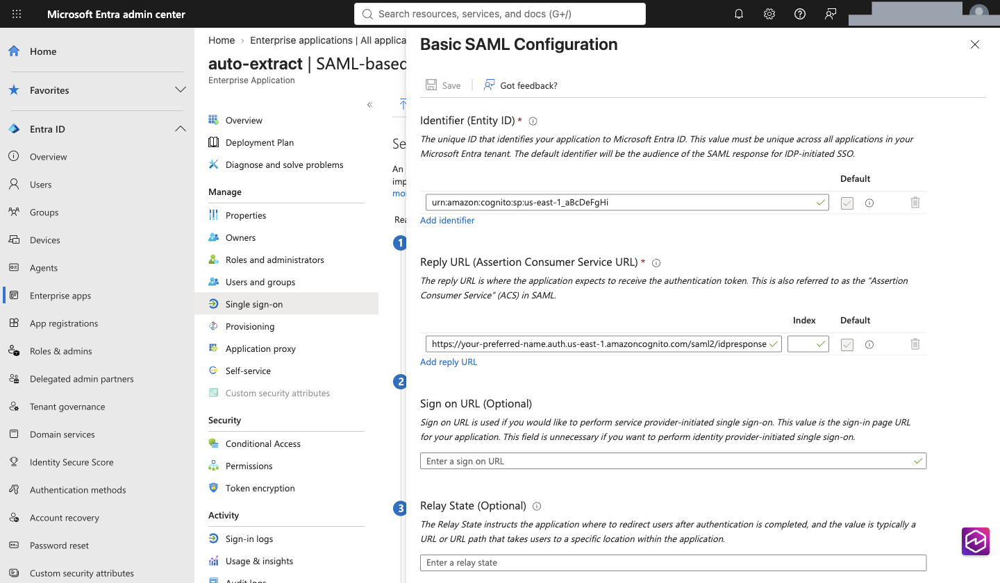

SAML Certificates にある Federation Metadata XML の Download を選択して、XML ファイルを入手します。

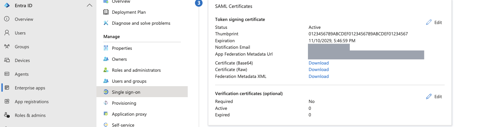

このアプリケーションにログインできるユーザーやグループを割り当てます。Users and groups のメニューで Add user/group を選択します。ここで割り当てたユーザーやグループのみログインできます。

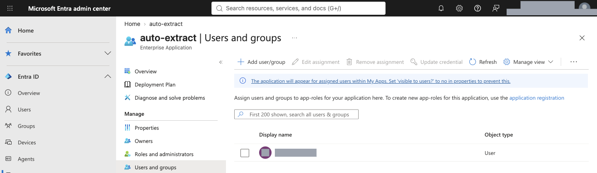

Add Assignment の画面で Users（グループも割り当てられる場合は Users and groups）の None Selected を選択します。

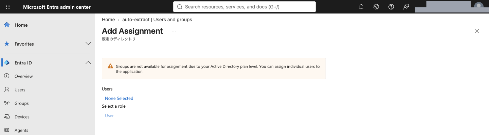

割り当てるユーザーを選んで Select を押し、Add Assignment の画面に戻って Assign を押します。

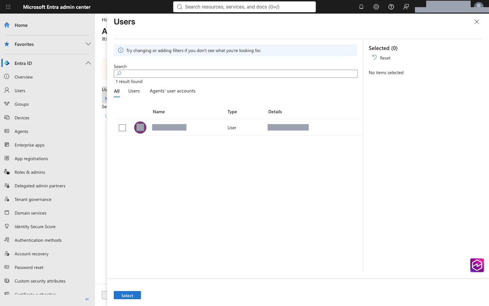

> [!NOTE]
> Microsoft Entra ID Free では、アプリケーションにグループを割り当てられず、ユーザーを個別に割り当てます（上の画面の警告）。グループを割り当てるには Microsoft Entra ID P1 以上が必要です。

# Cognito の設定 : フェデレーション

AWS マネジメントコンソールで Cognito の設定に戻ります。左メニューの「認証」>「ソーシャルプロバイダーと外部プロバイダー」を開き、「アイデンティティプロバイダーを追加」を選択します。

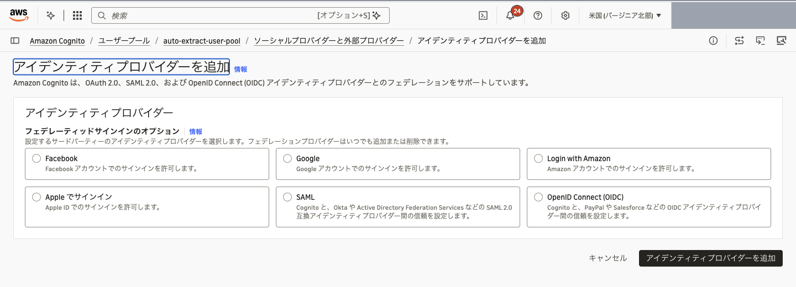

Entra ID の連携で SAML を利用するため、SAML を選択します。

自己登録（セルフサインアップ）が有効なユーザープールでは、SAML を選んだときに自己登録を無効にするよう警告が表示されます。このアプリは `samlAuthEnabled` を `true` にしてデプロイするとセルフサインアップを無効にするので、ここでは変更しなくて構いません（[lib/parameters.ts の編集](#libparametersts-の編集)）。

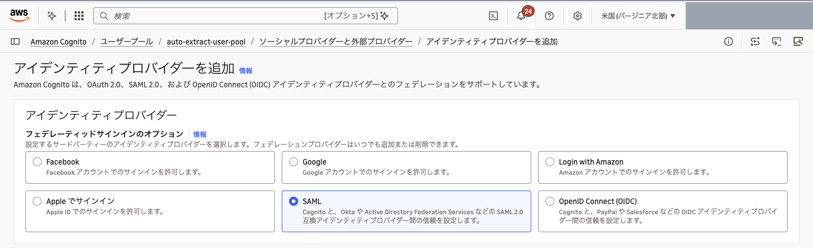

「プロバイダー名」に識別しやすい名前を入れます。ここで指定したプロバイダー名を、後の手順で `lib/parameters.ts` に記載します。この例では `EntraID` とします。
「メタデータドキュメントのソース」で「メタデータドキュメントをアップロード」を選び、「ファイルを選択」から Entra ID でダウンロードした Federation Metadata XML をアップロードします。

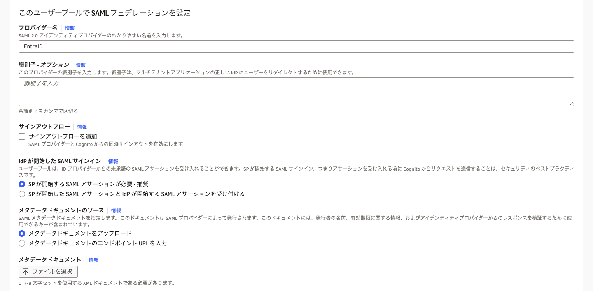

「SAML プロバイダーとユーザープールの間で属性をマッピング」で、「別の属性を追加」から次の属性マッピングを追加し、「アイデンティティプロバイダーを追加」を押します。`name` はこのアプリの表示名に使います。マッピングしない場合、表示名はメールアドレスになります。

| ユーザープール属性 | SAML 属性 |
|---|---|
| `email` | `http://schemas.xmlsoap.org/ws/2005/05/identity/claims/emailaddress` |
| `name` | `http://schemas.microsoft.com/identity/claims/displayname` |

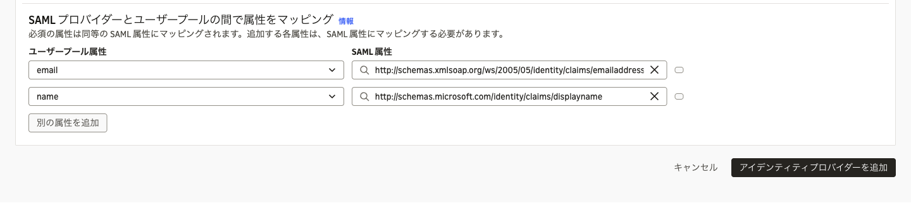

# Cognito の設定 : マネージドログイン

追加した Entra ID との連携をマネージドログインで利用するための設定をします。左メニューの「アプリケーション」>「アプリケーションクライアント」を開き、CDK が作成したアプリケーションクライアント（名前が `AuthUserPoolUserPoolClient` で始まるもの）を選択します。「ログインページ」タブの「マネージドログインページの設定」にある「編集」を押します。

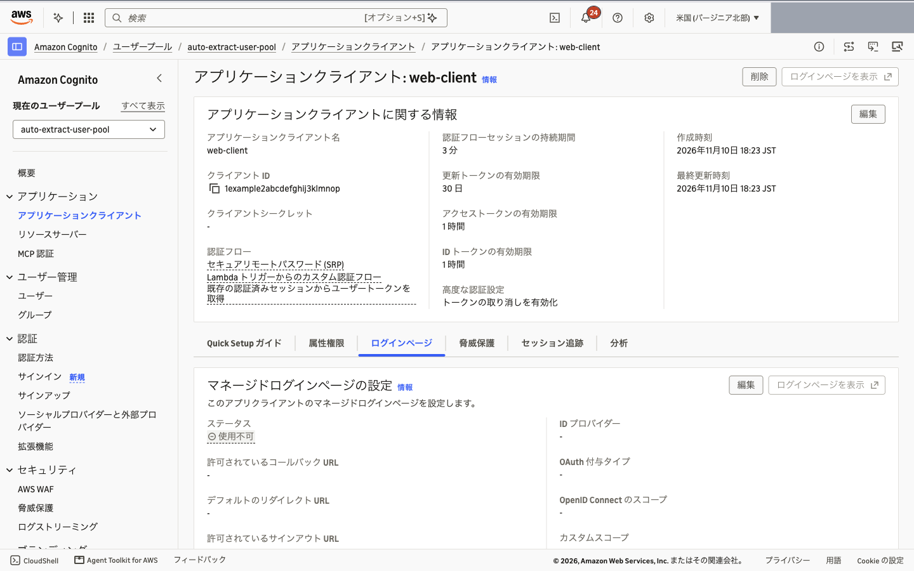

[事前作業](#事前作業)で確認した WebUrl を「許可されているコールバック URL」と「許可されているサインアウト URL」に入力します。URL は完全一致で照合されるため、末尾に `/` を付けずに入力してください（例: `https://d1234example.cloudfront.net`）。CDK が設定した `https://example.com` は削除して構いません。

[ローカル開発](DEPLOYMENT.md#ローカル開発)でフロントエンドを動かしてログインを試す場合だけ、`http://localhost:3000` も両方に追加します。本番環境では追加しないでください。

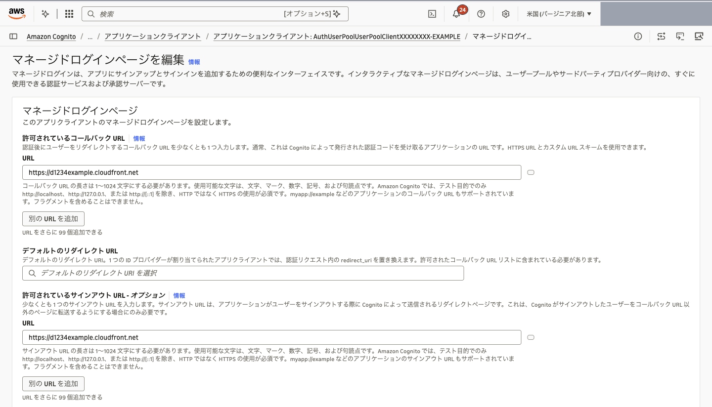

続けて次のように設定し、「変更を保存」を押します。

- ID プロバイダー: `EntraID` を選択します。Cognito ユーザープールを利用した認証は停止したいため、「Cognito ユーザープール」は外します。
- OAuth 2.0 許可タイプ: 「認証コード付与」を選択します。「暗黙的な付与」は使いません。
- OpenID Connect のスコープ: 「OpenID」「E メール」「プロファイル」を含めます。

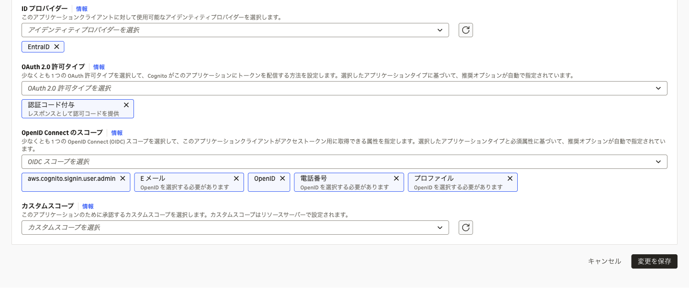

# lib/parameters.ts の編集

これで設定が完了したため、`lib/parameters.ts` の値を変更します。

- `samlAuthEnabled` : `true` を指定します。ログイン画面が SAML 専用に切り替わり、メールアドレスとパスワードのログインとセルフサインアップは使えなくなります。
- `samlCognitoDomainName` : [「Cognito の設定 : ドメイン」](#cognito-の設定--ドメイン) で作成した Cognito ドメインを、`https://` を付けずに入力します。
- `samlCognitoFederatedIdentityProviderName` : [「Cognito の設定 : フェデレーション」](#cognito-の設定--フェデレーション) で設定したプロバイダー名を入力します。

```typescript
// lib/parameters.ts
const envOverrides: Record<string, Partial<AppParameters>> = {
  dev: {
    samlAuthEnabled: true,
    samlCognitoDomainName: "your-preferred-name.auth.ap-northeast-1.amazoncognito.com",
    samlCognitoFederatedIdentityProviderName: "EntraID",
  },
  // ...
};
```

`samlAuthEnabled` が `true` なのにドメイン名かプロバイダー名が空、またはドメイン名に `https://` やパスが付いている場合は、デプロイ（synth）時にエラーになります。

設定後、再度デプロイを行うと SAML 連携が有効化されます。

```sh
npm run cdk:deploy -- dev --region ap-northeast-1
```

# 初回ログイン後のユーザー

Entra ID でログインしたユーザーは、ログイン直後にフロントエンドが呼ぶ `POST /user/sync` で Aurora DSQL の `users` テーブルに登録されます。新規ユーザーのロールは `author` です。

管理画面を使うには管理者が必要です。既存の管理者がいれば、管理画面のユーザー一覧からロールを `admin` に変更してください。管理者がいない場合は、DSQL で直接変更します。

```sql
UPDATE users SET role = 'admin', updated_at = now() WHERE email = 'admin@example.com';
```

# 出典

手順の構成とログイン画面の実装方式は、[aws-samples/generative-ai-use-cases の Microsoft Entra ID と SAML 連携](https://github.com/aws-samples/generative-ai-use-cases/blob/main/docs/ja/SAML_WITH_ENTRA_ID.md)（[MIT-0](https://github.com/aws-samples/generative-ai-use-cases/blob/main/LICENSE)）を参考にしています。
